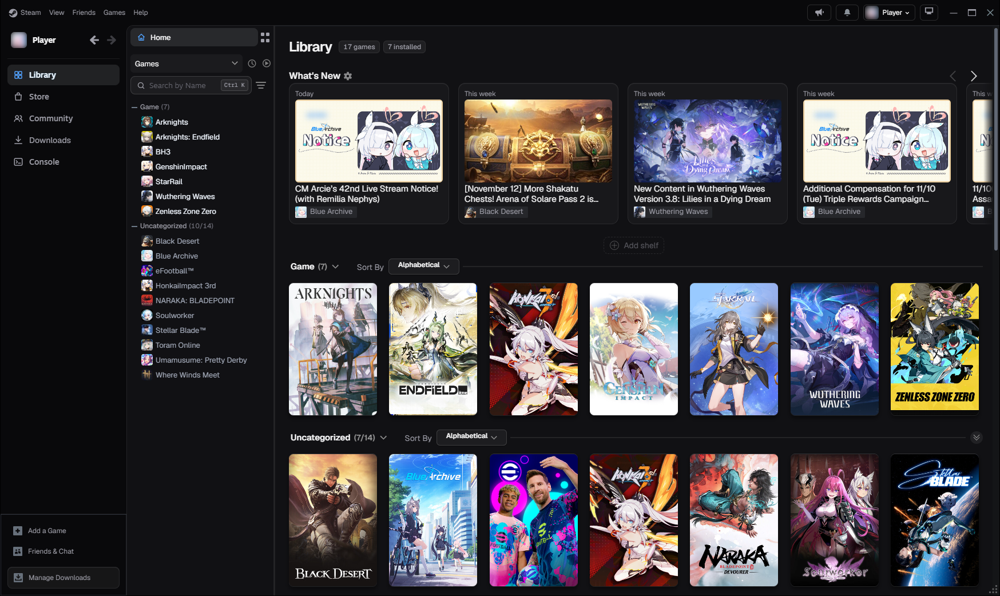
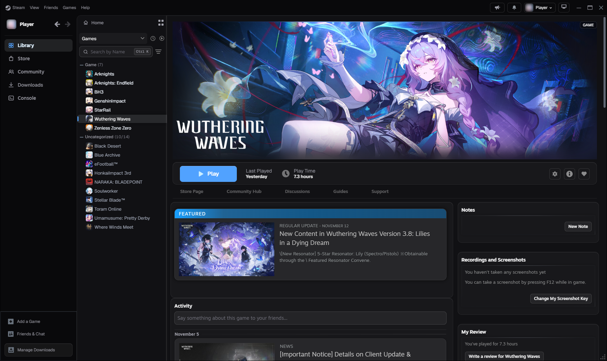
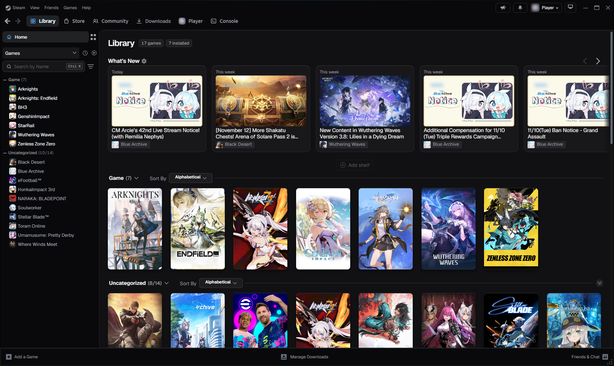
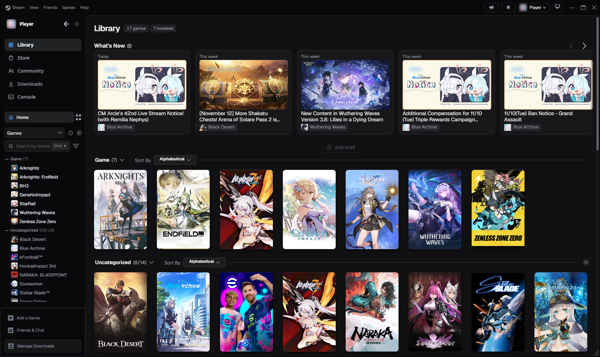
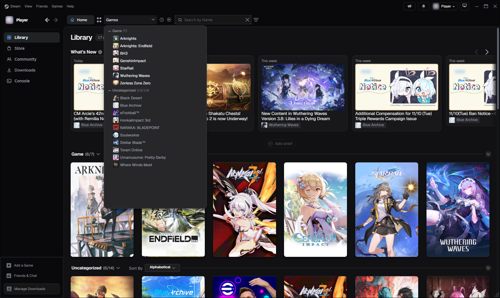

# Meridian

A calm, modern theme for the Steam desktop client, in dark, light or following Windows, made for [Millennium](https://github.com/SteamClientHomebrew/Millennium).

It makes Steam look and behave like a modern web app: neutral surfaces, hairline borders, one accent color and a clearer layout. Library, Store, Community, Downloads and your profile become one set of navigation items, in a left sidebar or in a row across the top. The page sits inside the window as a rounded card, game pages are built from cards, and the menus and dropdowns match.



## Features

- **Dark, light or follow Windows.** Light mode covers the main window, menus, dialogs, Settings, friends and chat, and the Store and Community pages. An optional surface tint gives the backgrounds a hint of your accent.
- **One navigation, two layouts.** Library, Store, Community, Downloads and your profile are the same icon-and-label items, in a left sidebar (**Left rail**) or in a row under the title bar (**Top tabs**). Right-click an item for its menu, so nothing pops open as you pass over it.
- **The page as a card.** Every page, Store and Community included, sits inside the window chrome with a small gutter, an edge and four rounded corners.
- **Four places for the game list.** Keep the Library's game list as its own column, blend it into the sidebar, move it inside the sidebar, or turn it into a bar above the page with a drop-down list.
- **Four accent colors.** Blue, Mint, Amber or Violet, used for Play buttons, progress bars, focus rings and highlights.
- **A clearer Library.** A heading with your game and install counts, **Ctrl+K** to jump to search, a flat game list, and cards for What's New and recent games.
- **Game pages built from cards.** The banner, the Play bar, the link tabs and every section are cards, and the Play bar becomes a frosted header as you scroll.
- **Downloads in the navigation.** A Downloads item that shows how many games are queued, and a Downloads page with the same headings and cards.
- **Matching menus, dialogs and windows.** Menus, dropdowns, dialogs, the Settings window, the friends list and chat, Store and Community pages and Big Picture use the same colors and corners.
- **One file to restyle it.** Every color, corner radius, shadow and font is a CSS variable in `tokens.css`.

## Screenshots

| | |
| --- | --- |
| <br>Game page | <br>**Navigation**: Top tabs |
| <br>**Library sidebar**: In the rail | <br>**Library sidebar**: Top bar |

## Design

The layout follows the [Meridian design mockup](https://claude.ai/artifact/8TiVdmBUq3HVG4pC4rLeNs), which has screens for the Library, Game page, Store, Downloads and Friends window.

The look comes from [Tailwind CSS v4](https://tailwindcss.com)'s default theme: its zinc greys and 400-step accent colors in OKLCH, its corner radius scale, translucent white borders, soft focus rings, and Geist with Geist Mono for type. Tailwind itself is not used or needed. Steam's markup can't take utility classes, so the theme keeps those values as CSS variables in `tokens.css`.

## What it covers

| Area | What changes |
| --- | --- |
| **Window** | The title bar and the navigation share one ground, and the page is a card inside it: an 8px gutter to its right and below, a 2px edge and all four corners rounded. The navigation items are Library, Store, Community, Downloads and your profile with your avatar. Each has an icon, and the page you are on is filled in. Downloads shows how many games are queued and lights up while you are on the Downloads page. With **Left rail** the items are stacked in a sidebar, with Back and Forward beside your profile, and Add a Game, Friends & Chat and the download progress card at the bottom. With **Top tabs** they sit in a row under the title bar, the game list becomes the sidebar in the Library, and the page beside it is the card. Right-click Store, Library, Community or your profile for its menu. |
| **Library** | A "Library" heading with badges for your game and install counts. Press **Ctrl+K** anywhere in the main window to jump to library search. Flat game list with a clear selected row, and Home and the collections button drawn like the navigation items. The **Library sidebar** option decides where the game list goes. Covers have an accent ring on hover and a matching preview card, recent games are cards with a Play button, and What's New items are cards. |
| **Game page** | The full banner art in a rounded card, a Play bar card that turns into a frosted header as you scroll, Store Page / Community Hub / Guides as a tab row, and each section as a card. News posts in the activity feed and the opened post are cards too. |
| **Downloads** | A "Downloads" heading with badges for the queue, the speed graph in a card, sentence-case section titles, and each queued game as a card with outlined buttons. |
| **Menus and dropdowns** | Compact rounded panels for the Steam/View/Games menus, right-click menus, Sort By and Settings pickers. They ease in when they open. |
| **Dialogs and buttons** | The main action in a dialog is the one filled accent button, everything else is grey. Text fields show a soft accent halo when focused. |
| **Settings** | The page list on the chrome color with a filled selected page, settings rows as cards, and toggles in the accent with a visible off track. |
| **Friends and chat** | Flat friends list, profile header, search box and rounded group rows. |
| **Store and Community** | The page card's edge and corners (the address bar, when shown, sits on the chrome above it, and the page's scrollbar becomes the right gutter). The top bar on the chrome color with Cart as the one accent button, a rounded featured carousel, underlined tabs, card rows, discounts as green badges and tags as outlined badges. Valve's newer pages, the wishlist and Your Personal Calendar, are themed too. Valve's pale text is remapped so it reads in light mode. |
| **Big Picture** | Steam's grey and accent colors remapped to the theme's, with flat accent Play buttons. |

## Requirements

- Steam for Windows
- [Millennium](https://github.com/SteamClientHomebrew/Millennium)

## Install

1. Download or clone this repository into Steam's Millennium themes folder, keeping the folder name `Meridian`:

   ```ps1
   cd "C:\Program Files (x86)\Steam\millennium\themes"
   git clone https://github.com/Sampong-Starluck/Meridian
   ```

2. Open Steam, go to the **Themes** tab in Millennium's settings, and choose **Meridian**.
3. Restart Steam when asked. The Store and Community styling only loads after a restart.

## Options

Change these in Millennium's theme settings for Meridian.

| Option | Choices | Default |
| --- | --- | --- |
| **Navigation** | **Left rail**: the navigation in a sidebar.<br>**Top tabs**: the same items in a row under the title bar.<br>In both, right-click Store, Library, Community or your profile for its menu. | Left rail |
| **Library sidebar** | **Side panel**: the game list as its own column inside the page.<br>**Blended**: the game list on the same dark ground as the navigation, with no line between them.<br>**In the rail**: the game list inside the left sidebar, under the navigation items. The sidebar gets a little wider to fit it. Left rail only.<br>**Top bar**: Home, the view picker and search in a row above the page. The game list drops down when you point at the view picker or search, or click into search. | Side panel |
| **Appearance** | **Dark**: zinc surfaces, as before.<br>**Light**: white panels on a light grey frame.<br>**Follow system**: light or dark to match Windows (Settings > Personalization > Colors > *Choose your default app mode*), switching as soon as you change it. | Dark |
| **Accent color** | Blue (Tailwind `blue-400`), Mint (`emerald-400`), Amber (`amber-400`), Violet (`violet-400`). Light mode uses a darker step of the same color (`blue-600`, `emerald-700`, `amber-700`, `violet-600`) so accent text stays readable on white. | Blue |
| **Surface tint** | **None**: neutral zinc greys.<br>**Subtle**: the backgrounds take a hint of your accent color.<br>**Strong**: twice as much. Works in dark and light mode. | None |

The accent color is used for Play buttons, progress bars, focus rings and highlights.

Light mode covers the main window, menus, dialogs, the friends and chat windows, and the Store and Community pages. Big Picture stays dark, since it is made for a TV across the room.

## Files

| File | Styles |
| --- | --- |
| `tokens.css` | Every color, corner radius, shadow and font, as CSS variables. All the stylesheets below import it |
| `libraryroot.custom.css` | The main window, the navigation items, library, game pages, menus, dialogs and notifications |
| `layouts/rail.css` | Where the navigation goes in the left sidebar layout (only when **Navigation** is **Left rail**) |
| `layouts/tabs.css` | Where the navigation goes in the top row layout, and the game list as a sidebar (only when **Navigation** is **Top tabs**) |
| `sidebar/blended.css`, `sidebar/in-rail.css`, `sidebar/top-bar.css` | Where the Library's game list goes (one of them is loaded when **Library sidebar** is not **Side panel**) |
| `libraryroot.custom.js` | Adds the Library and Downloads headings, your avatar and the Downloads item in the navigation, and the Ctrl+K search shortcut. Opens the Store / Library / Community / profile menus on right-click instead of on hover |
| `friends.custom.css` | Friends list and chat windows |
| `webkit.css` | Store and Community web pages |
| `store-react.css` | Valve's newer Store pages (wishlist, personal calendar): its design-system greys mapped to the theme, and overrides for the navy those pages hard-code. Imported by `webkit.css` |
| `bigpicture.custom.css` | Big Picture mode, Quick Access and the Steam menu |
| `accents/*.css` | One file per accent color |
| `modes/light.css` | The light palette: only the color variables change (loaded when **Appearance** is **Light**) |
| `modes/system.css` | Loads `modes/light.css` while Windows is set to light (when **Appearance** is **Follow system**) |
| `modes/dark.css` | Puts the dark colors back for Big Picture, which stays dark in light mode |
| `tints/subtle.css`, `tints/strong.css` | Tint the backgrounds with the accent color (loaded when **Surface tint** is not **None**) |

To change the look, edit `tokens.css`. Each variable has a comment naming the Tailwind utility it stands in for, for example `--mr-radius-lg` is `rounded-lg` and `--mr-line` is `border-white/10`.

## Notes

- **Steam updates:** Meridian targets Steam's readable class names (for example `TopBar` or `PlayBar`), not the auto-generated ones, so it usually survives Steam updates. If something looks off after an update, please open an issue.
- **Store header:** Steam's newer Store header uses auto-generated class names that change often, so Meridian styles it through attributes Valve keeps stable (the bar's feature target, the navigation and search roles, the cart link) instead. The discount badges on the Store home's sale tiles have no such hook and keep Steam's green.
- **Valve's newer Store pages:** the wishlist and Your Personal Calendar have no readable class names at all. `store-react.css` remaps Valve's own design-system colors, which have stable names, and repeats Valve's auto-generated selectors for the navy those pages hard-code. When Valve rebuilds a page and those names change, that part goes back to Valve's navy, which stays readable, until the theme is updated.
- **Changing Appearance or Surface tint:** the main window, menus and friends windows switch at once. Store and Community pages switch after you restart Steam, because Millennium decides at startup which option stylesheets web pages get.
- **Reduced motion:** with reduced motion turned on in Windows, the theme switches off its transitions.

## Limitations

- **JavaScript must be on.** The Library and Downloads headings, your avatar in the navigation, the navigation's Downloads item, Ctrl+K and the right-click navigation menus come from `libraryroot.custom.js`. With JavaScript turned off in Millennium, the theme still styles everything else, and the navigation menus open on hover as in plain Steam.
- **Navigation menus don't open on hover.** Pointing at Store, Library, Community or your profile no longer opens its menu; right-click it instead. A left click still opens the page.
- **English only.** The text the theme adds ("Library", "Downloads", "16 games", "6 installed", "2 in queue", "Ctrl K") is in English whatever language Steam uses.
- **Steam internals.** Game counts, the download badge and the Downloads highlight read Steam's internal stores (`collectionStore`, `downloadsStore`, `SteamUIStore`). If a Steam update renames them, those pieces disappear without an error, and the rest of the theme keeps working.
- **Ctrl+K needs the main window focused.** It doesn't work while you're clicked into a Store or Community page, because those pages are separate web views.
- **Badge delay.** The Downloads badge refreshes every 2 seconds, so it can lag slightly behind Steam.
- **Library sidebar.** **In the rail** needs **Navigation** set to **Left rail**, and the game list there can't be resized by dragging. With **Top bar** the game list is a drop-down, so it is only on screen while you use the bar.
- **Not built yet.** From the mockup: collection filter chips, the docked friends panel, and free disk space next to the counts. Steam has no element for them, and building them would mean hooking into Steam's filtering and window code.
- **Idle download card.** At the bottom of the sidebar, the download card puts its icon on its own line when nothing is downloading.

## Changelog

See [CHANGELOG.md](CHANGELOG.md) for what changed in each version.

## License

[MIT](LICENSE)
